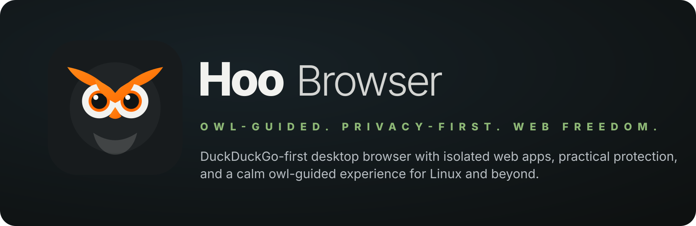

<p align="center">
  
</p>

<p align="center">
  <strong>OWL-GUIDED. PRIVACY-FIRST. WEB FREEDOM.</strong>
</p>

<p align="center">
  <a href="https://github.com/imranshiundu/Hoo-browser/actions/workflows/ci.yml"></a>
  <a href="LICENSE"></a>
  <a href="https://www.electronjs.org/"></a>
  <a href="https://www.typescriptlang.org/"></a>
  <a href="https://react.dev/"></a>
  
</p>

<p align="center">
  Hoo Browser is a DuckDuckGo-first desktop browser focused on practical privacy,
  isolated web apps, and a calm, watchful browsing experience for Linux and beyond.
</p>

---

# Hoo Browser

Hoo Browser is an experimental desktop browser shell built with Electron, TypeScript and React. The goal is a real installable Linux-first browser for DuckDuckGo-first search, isolated web apps, practical privacy controls, encryption-aware local data, and optional local-first AI assistance.

Hoo is owl-guided: the browser should feel watchful, calm, useful, protective, and honest about what it can and cannot do. That honesty extends to this README — everything listed here exists in the code, and the [known problems](#known-problems) section is kept up to date on purpose.

```text
src/main/       Electron main process — 14 modules for tabs, storage, privacy, downloads, auth
src/preload/    Typed contextIsolation bridge — renderer never touches Node
src/renderer/   React 19 UI — views, command palette, settings, branding
tests           Vitest unit suite over the main-process privacy & storage logic
```

## Why this project is interesting

Building a browser shell means taking real responsibility for the parts most
apps never touch:

- **Network policy engine** — a typed request classifier (`network-policy.ts`)
  that decides per-request blocking across four performance modes, with
  compatibility exemptions for sites that break under aggressive privacy rules.
- **Privacy filter pipeline** — ad/tracker host matching, forced-redirect
  scam detection, third-party cookie/referer stripping, and `X-Client-Data`
  removal (`privacy-filters.ts`), all covered by unit tests.
- **Resilient profile storage** — atomic JSON writes with quarantine of
  corrupted profiles and transparent reads of legacy `safeStorage`-encrypted
  data (`storage.ts`).
- **Process discipline** — tab lifecycle states (`placeholder → loaded →
  sleeping → crashed`), download danger hints for executable files, and a
  strict main/preload/renderer boundary.

## Current status

Version: `v0.4 Feels Like A Browser`

The current codebase includes working early versions of:

- Chromium rendering through Electron `BrowserView`
- tabs with persisted basic state and a documented lifecycle
- **drag-to-reorder tabs** (pinned tabs stay locked to the left edge, order survives restarts)
- navigation controls and DuckDuckGo-first home search
- **single-instance lock**: launching Hoo again focuses the existing window and opens any URL passed on the command line
- **window state persistence**: restarts reopen at your size/position/maximized state (clamped to the nearest display so a stale position can never strand the window)
- **a real icon set** (PNG/ICO/ICNS generated from the SVG master) — the taskbar, dock, and packages show the owl, not the default Electron icon
- an application menu whose accelerators work **inside web pages**: Ctrl+T/W/N new & close tabs, Ctrl+Tab and Ctrl+1–9 to switch, Ctrl+R / Ctrl+Shift+R reload, Alt+←/→ back/forward, Ctrl+F find, Ctrl+J downloads, Ctrl+0/+=/- zoom, F12 devtools, Ctrl+P print
- find in page with live match counts ("3 of 17")
- real favicons captured from pages (no third-party favicon service), with privacy-preserving letter avatars as fallback — **and favicon URLs persisted on the tab record so restarts keep tab identity**
- **a bookmark star that toggles**: filled while the current page is saved, click again to remove
- downloads: tracked, live progress in the toolbar, open file / show in folder, executable danger hints
- right-click context menu inside web pages (copy, search selection, open link, save image)
- loading feedback: tab spinners, an indeterminate progress bar, a working stop button, and back/forward buttons that disable themselves
- audio tab indicators with click-to-mute, link-hover URL preview, window title that follows the page
- crash handling: a crashed renderer shows a recoverable error page instead of a silent blank rectangle, **plus a session-recovery notice on the next launch**
- **double-click the title bar to maximize** (desktop convention)
- **macOS dock click reopens a window** instead of leaving a zombie process
- isolated web-app profiles (persistent partitions per app)
- privacy toggles, bookmarks, RSS reader
- simple ad/tracker host blocking with compatibility allowlist
- HTTPS upgrade for HTTP URLs, optional user-agent control
- local storage through Electron `safeStorage` where available
- OpenClaw AI panel (local gateway, explicit user-gated context)
- Linux install/update scripts and cross-platform packaging metadata
- Vitest unit tests and GitHub Actions CI

The important work now is to make the project stable, testable, installable, and honest — the `v0.3 Stable Tabs` milestone (navigation state, find, downloads, crash handling, app-wide shortcuts) has shipped, and `v0.4 Feels Like A Browser` (drag-reorder, single instance, window restore, real icons, bookmark toggle) has shipped on top of it. The next milestone is `v0.5 Web Apps` / permissions UX.

## Test suite

The privacy and storage logic is unit-tested with Vitest:

```bash
npm install
npm test          # run the Vitest suite
npm run typecheck # strict tsc --noEmit over src/
npm run build     # webpack build (main + preload + renderer)
npm run verify    # project verification + build
```

CI (`.github/workflows/ci.yml`) runs typecheck, tests, and a production build
on every push and pull request to `main`.

Covered modules today:

| Module | What the tests pin down |
| --- | --- |
| `privacy-filters.ts` | request blocking rules, compatibility-host exemptions, hard-blocked scam hosts, third-party header stripping, URL safety checks |
| `network-policy.ts` | low-data/lite/extreme/compatibility mode behavior for fonts, media, beacons, prefetch and tracker hosts |
| `storage.ts` | profile normalization, corrupt-tab filtering, active-tab validation, atomic save/load round-trips |
| `download-manager.ts` | filename sanitization and executable danger hints |
| `tab-utils.ts` | collision-free tab ids, zoom clamping/stepping, find-bar status text, crash reason labels, byte formatting, drag-reorder id mapping, window-state clamping |
| `types.ts` (renderer) | privacy-preserving site-initial avatars used instead of third-party favicon services |
| `branding assets` | the generated PNG/ICO/ICNS icon set exists so builds can never silently lose the app icon again |

## Install on Linux

Requirements: Node.js 18+, npm 9+, Git, an Electron-supported Linux desktop.

Install directly from GitHub:

```bash
curl -fsSL https://raw.githubusercontent.com/imranshiundu/Hoo-browser/main/scripts/install-hoo.sh | bash
```

The installer:

- clones Hoo into `~/.local/share/hoo-browser`
- installs dependencies and builds the app
- creates a `hoo-browser` launcher in `~/.local/bin`
- creates a desktop launcher so Hoo appears in the app menu
- installs a user-level systemd timer that checks for updates every 7 days

Start it from your app launcher or run `hoo-browser`.

## Development setup

```bash
git clone https://github.com/imranshiundu/Hoo-browser.git
cd Hoo-browser
npm install
npm run dev:start   # build + launch
npm start           # launch a built app
npm test            # unit tests
npm run typecheck   # tsc --noEmit
```

Packaging:

```bash
npm run dist            # AppImage + deb (Linux)
npm run dist:appimage   # AppImage only
npm run dist:deb        # deb only
npm run dist:win        # NSIS + portable (Windows)
npm run dist:mac        # dmg + zip (macOS)
```

Packaging needs clean-machine verification before release builds are advertised.

## Architecture notes

```text
src/
  main/                 Electron main process
    main.ts             window + BrowserView orchestration, IPC surface
    storage.ts          atomic profile persistence, crash records, retention
    privacy-filters.ts  ad/tracker/scam filtering, header hygiene
    network-policy.ts   per-mode request policy (balanced/lite/extreme/compatibility)
    tab-lifecycle.ts    tab runtime state machine
    download-manager.ts download records, executable danger hints
    auth.ts, sync.ts, update-service.ts, protocols.ts, ...
  preload/
    preload.ts          contextIsolation bridge — the only renderer door
  renderer/
    App.tsx + views/    React 19 interface
    components/         command palette, settings, panels
docs/
  native-security-architecture.md   security design notes
  browser-hardening-phase-1.md      hardening log
  real-browser-checklist.md         what "real browser" requires
  encryption-plan.md                local data encryption plan
  performance-budget.md             performance targets
  rebuild-plan.md                   roadmap details
```

## Personal path policy

Do not commit personal machine paths such as `/home/imran/...` into product
UI, docs, defaults, or screenshots. Use generic paths only
(`~/.config/hoo-browser`). Local developer paths belong in a private `.env`
that is git-ignored.

## Known problems

These are tracked honestly instead of hidden:

1. The ad/tracker blocker uses a curated static list, not maintained filter lists.
2. Random user-agent rotation can make fingerprinting worse if used incorrectly.
3. Permission prompts for camera, microphone, notifications, location, and clipboard need a visible Hoo-controlled UX.
4. ~~Crash recovery needs further implementation~~ Crashed tabs now show a recoverable error page, are recorded, and a session-recovery notice appears on the next launch; a one-click "restore all crashed tabs" UX is still missing.
5. ~~The project has no automated tests yet.~~ Main-process logic and key renderer helpers are unit-tested; full component tests are still missing.
6. RSS currently depends on renderer-side fetching patterns that should move to the main process.
7. Cloud sync needs stronger conflict handling and clearer data boundaries.
8. IPC actions need tighter validation as the browser grows.
9. AppImage/deb builds need clean-machine verification.
10. Zoom level is remembered per tab in memory only; per-site zoom persistence is not implemented yet.
11. Bookmark folders, search inside history, and bookmarks import/export are not implemented yet.
12. Tab drag-reorder is HTML5-based; dragging a tab out of the strip to tear it into a new window is not supported yet.

## Keyboard map

Every shortcut below is an application-menu accelerator, so it works while a
web page has focus — not only while the Hoo UI is focused:

| Keys | Action |
| --- | --- |
| Ctrl+T / Ctrl+W | new tab / close tab |
| Ctrl+Shift+T | reopen closed tab |
| Ctrl+Tab / Ctrl+Shift+Tab | next / previous tab |
| Ctrl+1…8, Ctrl+9 | switch to tab by position (9 = last) |
| Ctrl+L focus | address bar (renderer shortcut) |
| Ctrl+R / Ctrl+Shift+R | reload / force reload |
| Alt+← / Alt+→ | back / forward |
| Ctrl+F | find in page (live match counts) |
| Ctrl+J | downloads panel |
| Ctrl+= / Ctrl+- / Ctrl+0 | zoom in / out / actual size |
| F12 / Ctrl+Shift+I | developer tools for the page |
| Ctrl+P | print page |
| Ctrl+, | settings |

## Rebuild path

- `v0.1 Foundation` — honest docs, build scripts, verification, project contract
- `v0.2 Hoo Foundation` — Hoo identity, installer path, branded home UI, packaging metadata, **test suite + CI**
- `v0.3 Stable Tabs` — reliable tab restore, navigation state, crash handling, app-wide shortcuts, find/downloads/favicons wiring
- `v0.4 Feels Like A Browser` — drag-to-reorder tabs, single-instance lock, window state restore, real icon set, bookmark toggle, session-recovery notice ← *current*
- `v0.5 Web Apps` — isolated app profiles, permissions, reset controls
- `v0.6 Privacy Controls` — maintained filters, allowlists, visible blocked counts, stable fingerprint profile
- `v0.7 Local Assistant` — streaming, explicit context, provider settings, local/cloud warnings
- `v0.8 Sync and Encryption` — safe sync scope, conflict handling, encrypted backup/import/export
- `v0.9 Packaging` — verified AppImage, deb, icons, desktop entry
- `v1.0 Daily Driver` — only after stability, packaging, tests, and privacy docs match behavior

Read the detailed plan in [`docs/rebuild-plan.md`](docs/rebuild-plan.md).

## Contributing

Keep the project plain and professional.

- Do not oversell features.
- Do not add fake privacy claims.
- Do not add hidden telemetry.
- Do not send page content to AI providers without explicit user action.
- Do not commit personal laptop paths or local-only folder structures.
- Prefer small verified patches over huge rewrites; add or update tests for anything touching `src/main`.
- Document every feature that touches user data.

See [CONTRIBUTING.md](CONTRIBUTING.md) and [SECURITY.md](SECURITY.md).

## License

[MIT](LICENSE) — Copyright (c) 2026 Imran Shiundu
